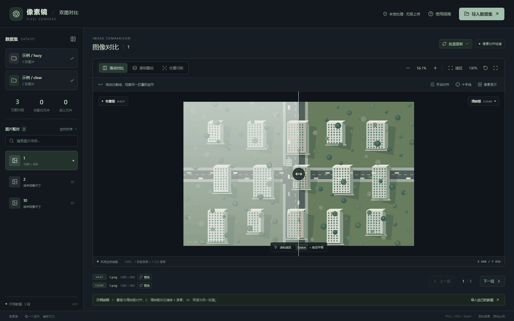
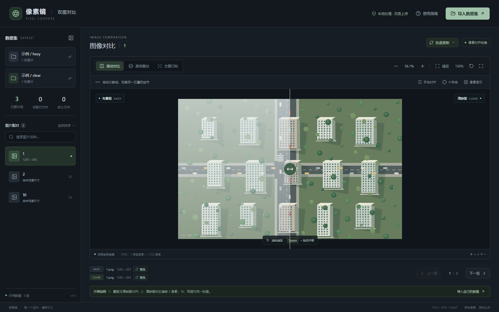

# Pixel Compare / 像素镜 · 双图对比

**Compare two images side by side, inspect pixel alignment, and review before/after results locally in your browser.** Pixel Compare is useful for computer vision, AI image generation, image restoration, design review, and any workflow where two images should line up. Your images stay on your computer; the app does not upload them.

[Download the Windows package](https://github.com/Gululu-gulu/pixel-compare/releases/latest) · [Read the Chinese guide](#中文说明)



### Features

- Compare paired image folders by matching filenames.
- Drag the center divider, blend images with adjustable opacity, or blink between them.
- Zoom, pan, inspect pixel coordinates, and manually align images.
- Runs locally in Chrome or Edge. No account, cloud service, or external API is required.

### Quick start

Download and extract the Windows package from [GitHub Releases](https://github.com/Gululu-gulu/pixel-compare/releases/latest), then double-click `启动平台.cmd`. The included demo can be opened before selecting your own image folders.

For source installation, use Node.js 22.18 or newer:

```bash
git clone https://github.com/Gululu-gulu/pixel-compare.git
cd pixel-compare
npm install
npm run dev
```

## 中文说明



---

### 项目简介

在浏览器中批量对比两组同名图片，检查原始图像是否像素级对齐。它可以用于有雾图/清晰图、原图/生成图、Before/After、输入/输出、参考图/预测图、渲染结果/实拍图、配准前/配准后等场景。支持单张替换、按同名批量更新，以及手动对齐和 PNG 导出。React + TypeScript + Vite 实现；所有图片在浏览器本地解码，不上传，不依赖在线 API、字体或 CDN。

## 直接使用已构建版本

交付包包含完整源码和 `dist/` 生产构建。Windows 用户解压后双击 `启动平台.cmd` 即可运行，不需要先安装依赖。

1. 解压整个压缩包，保留目录结构。
2. Windows 双击 **启动平台.cmd**，会启动本地服务并打开浏览器。保持终端窗口开启，按 Ctrl+C 关闭服务。
3. 也可安装 Node.js **22.18 或更新版本**，在本项目目录执行：

   ```bash
   node serve.mjs
   ```

4. 访问 **http://127.0.0.1:4173/**，点击“选择数据集目录”。首次可以点击“先试试示例数据”。

Windows 启动脚本会先寻找系统 Node.js；若未找到，再尝试本机 Codex 已有的 Node.js 运行时。仓库下载包带有已构建版本，正常启动不需要 npm 或联网。若你拿到的源码包没有 `dist/`，启动脚本会尝试用 npm 安装依赖并构建，因此首次构建需要联网。不要通过双击 `dist/index.html` 以 `file://` 方式运行。

## 从 GitHub 获取

如果你把项目上传到自己的 GitHub，可以在另一台电脑上这样获取源码：

```bash
git clone https://github.com/Gululu-gulu/pixel-compare.git
cd pixel-compare
npm install
npm run dev
```

如果只是使用已经构建好的版本，也可以在 GitHub 仓库中下载 ZIP；解压后双击 `启动平台.cmd`。GitHub 仓库只包含项目源码、内置演示图和构建文件，不包含你的数据集或个人图片。

默认服务仅监听本机 `127.0.0.1`。端口被占用时，可设置 `PORT` 后运行，例如 PowerShell：

```powershell
$env:PORT = '4180'
node serve.mjs
```

## 从源码开发和构建

环境要求：Node.js **22.18+** 和随 Node.js 安装的 npm。优先使用桌面版 Chrome 或 Edge。

```bash
npm install
npm run dev
```

访问终端显示的地址，默认 **http://127.0.0.1:5173/**。首次安装依赖需要联网；依赖安装完成后，断网仍可启动和使用。若开发端口被占用，Vite 会显示实际端口。

```bash
npm run build
npm run preview
```

`build` 先执行严格 TypeScript 检查，再输出生产文件到 `dist/`；`preview` 默认使用 **http://127.0.0.1:4173/**。也可以用上述零依赖 `node serve.mjs` 运行生产构建。将本项目及其 `dist/` 复制到另一台电脑后，只需 Node.js 即可启动。

## 准备图片和导入

```text
dataset/
├── hazy/
│   ├── 1.png
│   ├── 2.jpg
│   └── 10.webp
└── clear/
    ├── 1.png
    ├── 2.png
    └── 10.webp
```

- **整组导入**：点击顶部“导入数据集”或中央“选择数据集目录”，选择上面的 `dataset`。`hazy/clear` 会按传统有雾数据集识别；任意两个直属图片子文件夹也可以使用，例如 `before/after`、`input/output`、`reference/prediction`。
- **分别导入**：点击左侧两张图层卡片，分别选择任意两个图片文件夹。此方式适合根目录中有多个实验子目录的情况。
- 浏览器可能显示“上传文件夹”确认字样，这是浏览器选择本地目录的通用措辞；应用没有图片上传接口，也不会向服务器发送图片。
- 仅索引两侧文件夹的直属 **PNG、JPG、JPEG、WebP** 图片，扩展名不区分大小写。更深子目录和非图片文件会被忽略。浏览器目录选择器不会返回空目录，因此空目录会显示未找到可用图片。
- 文件名去掉扩展名后**精确匹配且区分大小写**。`hazy/1.jpg` 能与 `clear/1.png` 配对；`01` 与 `1`、`A` 与 `a` 是不同名称。按自然顺序排序：`1、2、3、10`。
- 一侧存在 `1.jpg` 与 `1.png` 时，同名组存在歧义，整组跳过，不自动选择。缺失对应文件的图片也会跳过。
- 侧栏显示有效配对组数、未配对文件数和歧义文件数。点击统计或“查看导入问题”可查看、搜索问题列表；数量按涉及的实际文件计数。同一名称可能同时缺失另一侧且有重复文件，因此两类统计可能重叠。
- 只保存文件索引，打开某组时才解码两张图片。刷新页面后需要重新选择目录；不会修改源文件。

## 适用场景

像素镜不理解图片语义，也不执行自动美化，因此适合任何需要确认“同一个位置是否仍然对应”的任务：去雾、去雨、低照度增强、超分辨率、图像复原、AI 生成结果检查、Before/After 设计稿、医学/遥感/显微镜图像、渲染图与实拍图、配准和压缩流程的像素级回归检查。它关注的是几何位置和像素差异，不会把“看起来更好”当成对齐成功。

## 对比与浏览

| 操作 | 使用方法 |
| --- | --- |
| 左右滑动 | 默认左侧为有雾图，右侧为清晰图。拖动中间圆形按钮，可拖至两端完整查看任意一张图。 |
| 切换图片对 | 底部“上一组 / 下一组”、左右方向键，或点击左侧列表。输入框、下拉框和分割线有焦点时不会误触全局切换。 |
| 搜索 | 在左侧输入配对名称，不限制当前已选图片，点击搜索结果即可跳转。 |
| 缩放 | 鼠标位于画布内滚动，以鼠标位置为中心缩放；也可点击“+ / −”。手动缩放范围为 0.1%～6400%。 |
| 平移 | 按住空格，在画布内按住鼠标左键拖动。松开空格或鼠标后结束对应操作。 |
| 适应 | 保持原始宽高比，在画布内完整显示图片。窗口或侧栏改变大小后自动重新适应。 |
| 100% | 1 个原图像素对应 1 个 CSS 像素；高 DPI 屏幕的 CSS 像素与物理屏幕像素可能不同。 |
| 重置 | 重置为适应窗口，并把分割线恢复到 50%。 |
| 像素显示 | 开启后关闭平滑插值，使用最近邻，便于放大检查像素边缘。 |
| 十字线 | 显示光标辅助十字线。右下角显示原图坐标，左上角为 `(0, 0)`；超出图像范围时显示 `—`。 |
| 全屏 | 点击工具栏最右侧按钮，Esc 退出。 |

分割线支持键盘：Tab 聚焦分割线后，左右键每次移动 1%，Shift + 左右键每次移动 10%，Home / End 移至两端。

### 透明叠加

点击“透明叠加”，调节上层清晰图透明度（0%～100%，默认 50%），观察边缘重影。两层共用坐标变换。

### 交替闪烁

点击“交替闪烁”，然后点击“开始”。可设置 100、250、500、1000、2000 毫秒间隔，默认 500 毫秒。画面和文字标注同步切换。点击“暂停”停止在当前帧；离开闪烁模式立即停止计时器。切组加载期间不闪烁，新图片准备好后按当前播放状态继续。

切换图片对时保留对比模式、透明度、分割线百分比和辅助选项；缩放和平移重置为适应窗口。加载中清空上一组画面，两张新图都解码完成后同时显示。

## v1.1：修改后快速更新图片

**只修改一张：** 在底部 HAZY 或 CLEAR 文件名旁点击“替换”，选择修改后的图片。可以选择不同文件名，仍保留当前配对编号。当前组、手动视图的缩放/中心、分割线、对比模式和透明度保留；不需要重新导入整个文件夹。文件选择完成后才更新，取消选择不会改变当前图片。同一文件可以反复选择，方便外部保存后重新读取。

**修改多张：** 在工作台右上角点击“批量更新”，先选“有雾图”或“清晰图”，然后一次选择多张。按不含扩展名的文件名精确匹配现有配对，区分大小写；不新增或重排配对。未知名称、同次选择中的重复主文件名和不支持的格式跳过，并在顶部说明原因。只更新选中侧，另一侧保持当前文件。

**恢复最初导入文件：** 替换后，底部该侧旁会出现回退图标，可以恢复该组最初导入的文件。它恢复的是浏览器最初取得的文件引用；若该原文件已在外部修改到浏览器无法读取，请重新选择当前文件。

更新或恢复某一侧图片时，**该组该侧的手动校正清零**，避免已在外部校正的图像再次套用旧参数；另一侧校正与其他组保持。该组旧的撤销/重做历史同时清空，以免撤销回到旧图片的参数。尺寸不同或图片损坏时仍会提示，可以直接再次替换修复。替换只在本次浏览器会话生效，不覆盖磁盘文件。

## v1.1：直接在平台手动对齐

1. 打开一组尺寸相同的图片，建议切到“透明叠加”，透明度设为 50%。
2. 点击“手动对齐”，选择要调整的 **有雾图** 或 **清晰图**。
3. 设置水平/垂直位移、图层缩放和旋转。位移以原图像素计，向右/向下为正；缩放与旋转围绕图片中心，正角度在屏幕上为顺时针。
4. 步长可选 0.1、1、10 px，点击四个方向按钮微调。面板打开时，Alt + 方向键按当前步长移动，Alt + Shift + 方向键移动 10 px；输入框获得焦点时不触发。
5. 开启“拖动此层”后，在画布空白控制区域直接拖动所选图层；分割线仍可拖动。空格 + 拖动始终只平移整个查看视图。拖动造成的位移会除以当前查看缩放，换算为原图像素；整次拖动只记为一次撤销操作。
6. 使用撤销/重做按钮回退或恢复，最多保留每组 100 步；“重置此层”只重置当前选中图层。所有参数按配对名称分别保存，切组不会丢失。侧栏铅笔与画布标记表示已替换或已校正。
7. 对齐完成后，选择要保存的图层，点击 **导出此层 PNG**。浏览器下载文件名使用配对名称，例如 `1.png`，便于继续配对。输出保持该图层原始宽高，按当前参数生成新 PNG，不覆盖源文件。

图层缩放与顶部查看缩放是两个独立概念：图层缩放会参与导出，顶部查看缩放只影响观察。调整后右下角坐标仍对应未变换的公共参考网格。旋转或位移后超出原始画幅的部分被裁剪，缺口保留透明；如需保留完整扩展画幅，需要另行裁剪规划。导出的插值方式与“像素显示”开关一致（开启时使用最近邻）。

**保存工作参数：** 面板底部“保存全部调整参数”下载所有已调整组的 JSON；下次重新导入对应原始数据集后，“载入调整参数”即可按名称恢复。参数文件只包含几何参数，不包含图像或替换文件；不同图片即使同名也不应套用同一份参数。未知名称跳过，非法参数整份拒绝，导入参数也可撤销。刷新页面会清除文件引用、替换和内存参数，因此结束前请导出需要的 PNG 或参数文件。

这属于显式手动校正，不会自动检测或掩盖原始错位。不同景深的视差、局部形变或拍摄视角差异，可能无法通过一套平移/缩放/旋转完全解决。

## 尺寸不一致、损坏文件和大数据集

- 每组打开时读取两张图片的真实像素尺寸，显示在底部，检查过的状态同时显示在侧栏。
- 尺寸不同会显示“图片尺寸不同，无法直接进行像素级对比”，列出两侧尺寸并停止显示该组；不会拉伸、裁剪或自动配准。仍可继续浏览其他组。
- 损坏或浏览器不支持的图片会提示具体侧别与文件名。有效配对数只表示名称匹配，不表示所有图片已完成解码；损坏、尺寸问题按需检查。
- 不一次性解码全部图片，仅持有当前组的两个 Object URL，切组或卸载及时释放。异步加载有取消标记，过期结果不能覆盖当前选择。
- 配对列表按可视范围渲染，支持数千组索引。单张超大图片的内存开销仍受浏览器和设备限制；平台不会为了规避限制而压缩源图。
- 导入时不实施去雾、增强、自动对齐或源文件写回。只有主动进行手动对齐时才应用几何变换，导出时生成新 PNG。浏览器会按其正常色彩管理和图片方向解释进行解码显示。

## 本地示例

内置示例为本项目生成的城市示意图，不读取任何用户照片：

- `1`：有雾图与清晰图几何对齐。
- `2`：清晰图向右偏移 3 个原图像素，可用叠加/闪烁观察轮廓跳动。
- `10`：两层完全相同，可验证拖动分割线不会引入位移。

示例文件也位于 `public/demo/hazy` 与 `public/demo/clear`，可直接作为文件夹导入。

## 验证

```bash
npm test
```

共 9 项测试，覆盖不同扩展名、自然排序、歧义、缺失、大小写、深层目录排除、5000 组索引、批量更新匹配、变换矩阵、历史记录及参数文件校验。

保持开发服务运行，在另一个终端执行：

```bash
npm run test:browser
```

浏览器测试默认使用已安装的 Microsoft Edge 的无界面模式。若没有 Edge，可先 `npx playwright install chromium`，再设置 `BROWSER_CHANNEL=chromium`；PowerShell 使用：

```powershell
$env:BROWSER_CHANNEL = 'chromium'
npm run test:browser
```

可通过 `TEST_URL` 指定其他测试地址，例如生产服务 `http://127.0.0.1:4173/`。测试自动生成并清理本项目 `work/` 下的测试目录，不改动用户图片。浏览器检查覆盖导入、配对统计、同图逐像素一致性、缩放和平移、透明度、闪烁、异常图片、快速切换、URL 释放、断网本地读取和窗口布局。

编辑检查还覆盖单张替换、重复选择同文件、批量更新、恢复原图、校正范围隔离、拖动撤销、精细步长、PNG 逐像素导出、原图哈希不变，以及参数文件导出/恢复。开发服务器不监听测试临时目录，避免 Windows 下载文件锁造成文件监视错误。

## 项目文件

```text
src/App.tsx        文件夹导入、配对列表、图片加载和浏览
src/pairing.ts     目录过滤和确定性配对规则
src/images.ts      两张图同时解码、错误处理与资源释放
src/Viewer.tsx     模式、工具栏、加载/异常界面
src/engine.ts      Canvas 共享变换、遮罩、缩放、平移和坐标
src/alignment.ts   校正矩阵、历史记录、参数校验和 PNG 导出
src/AlignmentPanel.tsx  手动对齐浮动面板
src/updates.ts     按同名批量更新匹配
src/styles.css     深色界面及窗口适配
public/demo/      三组本地示例
tests/            配对与浏览器检查
dist/             可直接运行的生产构建
serve.mjs         无第三方依赖的本地生产服务
启动平台.cmd      Windows 启动入口
```
